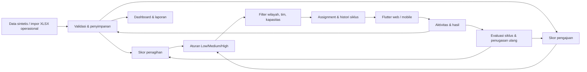

# Keputusan arsitektur — 27 Oktober 2026

## Dasar: gambar kedua

Gambar kedua di `brief-awal/preview-arsitektur-2.webp` menjadi dasar karena memisahkan preprocessing, prediksi supervised, segmentasi, dan assignment. Gambar pertama menambahkan scoring untuk collection service/institusi/lawyer eksternal, yang belum diperlukan oleh workflow inti. Interpretasi varian eksternal merupakan pembacaan diagram, bukan keputusan klien yang sudah dikonfirmasi.

Koreksi dari gambar: keluaran probabilitas harus disebut prediction, sedangkan segmentation menghasilkan segmen. Tambahkan feedback aktivitas, wilayah, kapasitas, audit, serta pemisahan penagihan/pengajuan. Tidak perlu data lake, mikroservis, atau tiga algoritma sekaligus pada awal prototype.

## Tech stack

- **Flutter/Dart**: satu kode aplikasi untuk web operasional dan mobile. Website ini berupa aplikasi internal dengan formulir dan antrean, sehingga sesuai penggunaan app-centric yang didukung [dokumentasi Flutter web](https://docs.flutter.dev/platform-integration/web/faq). Flutter bukan pilihan utama jika kelak diperlukan halaman pemasaran dengan SEO; halaman itu dapat menjadi proyek terpisah.
- **FastAPI/Pydantic/Python 3.12**: validasi request, OpenAPI, API bersama, dan tempat layanan prediksi Python. Tidak ada alasan membungkus layanan Python lewat backend kedua.
- **PostgreSQL + SQLAlchemy Core/Alembic sejak Sprint 7**: database demo utama pada klaster proyek loopback15432. Head schema kini0006_hardening setelah baseline0001_portable; SQL lama berparameter dijembatani adapter lintas dialek, bukan ORM. Mutasi memakai advisory transaction lock untuk mempertahankan single-writer prototype dan validasi kapasitas/uang atomik; pembacaan REPEATABLE READ/READ ONLY untuk laporan konsisten. Ini belum optimasi throughput produksi.
- **SQLite persisten tetap didukung untuk fallback/tes**: SQLAlchemy dengan foreign key/BEGIN IMMEDIATE, adopsi schema legacy v3 ke baseline Alembic. SQLite asli sebelum cutover dipertahankan, tanpa sinkronisasi balik otomatis. Migrasi hanya dari snapshot terverifikasi ke target kosong. Lihat [runbook PostgreSQL](postgresql.md).
- **State Flutter bawaan + paket HTTP** untuk irisan awal. Navigasi adaptif memisahkan sidebar desktop dan navigasi bawah mobile, mengikuti [pendekatan adaptive Flutter](https://docs.flutter.dev/ui/adaptive-responsive/general). Tambahkan pengelolaan state/routing lebih besar setelah kebutuhan navigasi stabil, bukan sebagai dependensi awal tanpa kebutuhan.
- **Model dan segmentasi**: Sprint9 menyediakan empat regresi logistik dengan artefak JSON, evaluasi held-out, kalibrasi, lifecycle dan fallback. Sprint10 menambah KMeans per cohort, profil/stabilitas dan kebijakan berversi. Keduanya menggunakan histori sintetis; efektivitas nyata belum divalidasi.

Bentuk aplikasi: monolit modular. API, domain, persistence, analitik/model, operasi dan UI terpisah dalam folder. Telephony/omnichannel memakai adapter tiruan persisten sejak Sprint12. Tidak memerlukan LLM runtime untuk keputusan assignment.

Sprint 4 menambah modul `backend/app/reports.py` untuk filter kohort, agregasi portofolio/siklus, serta CSV. Preview memakai snapshot baca SQLite; pembuatan ekspor dan audit berada dalam satu transaksi. Flutter `reports_page.dart` mengelola filter/preview, sementara unduhan Blob web dipisahkan melalui conditional export agar sumber tetap dapat dianalisis untuk target native. Definisi metrik dan batasnya ada di [laporan operasional](laporan-operasional.md).

Sprint 5 menambah `backend/app/imports.py` untuk template operasional, parser XLSX read-only (openpyxl/defusedxml), pemetaan, preview, deduplikasi referensi per alur dan commit atomik/idempoten. SQLite schema version 2 menambahkan `import_batches` dan `import_case_refs` tanpa menulis ulang tabel bisnis. Commit memakai `BEGIN IMMEDIATE`, memeriksa revisi/duplikasi/wilayah lagi, lalu menyimpan semua kasus dan audit bersama. Flutter `imports_page.dart` menyediakan wizard dan riwayat; picker/unduhan memakai conditional export web. Berkas tidak mengimpor histori, hasil transaksi, master atau memperbarui kasus lama. Detail API, batas dan recovery berada di [impor operasional](impor-operasional.md).

Sprint 6 menambah `backend/app/master.py`, `master_page.dart` dan `override_dialog.dart`. Master wilayah/petugas memakai versi dan validasi tugas berjalan; akun petugas awal dibuat atomik bersama profil. Override memilih kandidat eksplisit tanpa melewati aturan bisnis, memakai transaksi assignment yang sama dan kunci idempotency. Schema v3 menambah status/versi master, snapshot nama/tim/kanal pada siklus dan tabel retry override. Laporan mempertahankan scope historis setelah perpindahan profil. Wilayah nonaktif dikeluarkan dari input/impor, tetapi tetap tersedia untuk laporan. Detail dan batas ada di [master dan override](master-dan-override.md).

Sprint 7 memindahkan storage aktif ke PostgreSQL. Metadata mempertahankan uang integer rupiah, waktu UTC ISO text, JSON text serta BLOB/BYTEA demi kesetaraan kontrak API lama. Migrator membuat backup sumber read-only, menyalin seluruh data bisnis/hash password/ID/histori secara atomik, memverifikasi jumlah/hash, dan menyetel sequence. Sesi login sengaja tidak disalin. Receipt mencegah copy ulang; baseline Alembic beku dan schema/head diuji tanpa drift. PostgreSQL pengguna di5433 tidak diubah; script lokal proyek mengelola klaster sendiri, backup dump dan restore verifikasi.

Sprint 8 menambah `historical.py` (simulator, derivasi snapshot/label, purge waktu/identitas dan quality gate) serta `analytics.py` (API khusus supervisor, persistensi atomik/idempoten, pagination dan ekspor ZIP yang memeriksa hash). Lima tabel analytics_* ditambahkan melalui revision0002_analytics; raw history/keputusan/event dan snapshot disimpan terpisah dari tabel operasional. Flutter `analytics_page.dart` dibuka dari Ringkasan, tanpa menambah kepadatan navigasi bawah. Run bersifat immutable; seluruh raw data yang teramati, konfigurasi dan manifest dapat direproduksi dari seed. Tidak melatih model atau merekonstruksi histori operasional lama yang tidak mempunyai snapshot. Detail kontrak tersedia di [analitik historis](analitik-historis.md).

## Dua domain, target berbeda

**Penagihan**: keberhasilan assignment berarti seluruh nilai tagihan kasus terbayar maksimal 72 jam sejak penugasan pada siklus tersebut. Pembayaran parsial mengurangi sisa tagihan tetapi belum mengakhiri kasus. Pembayaran penuh terlambat menutup kasus sebagai `paid` dengan outcome assignment `no_success`. Dashboard menampilkan kasus selesai, bukan menyamakan semua lunas dengan sukses SLA.

**Pengajuan**: tujuan model kelak adalah konversi menjadi pencairan, terpisah dari tujuan penagihan. Alur awal: lead → assignment → kontak → dokumen lengkap → verifikasi → pencairan simulasi; penolakan bisa menutup kasus aktif dengan alasan. Mesin assignment tidak menyetujui kredit otomatis. Sejak Sprint 8 jendela label historis memakai **asumsi default30 hari**, dapat dipilih7–90 hari per run; belum keputusan bisnis final. SLA tindak lanjut demo72 jam tetap terpisah dari jendela konversi ML.

## Asumsi demo yang belum dikonfirmasi klien

1. A = petugas Tele; B = petugas Lapangan. Keduanya dibuat sebagai field tim dan kanal berbeda, walaupun seed memasangkannya.
2. Low selalu A, High selalu B, Medium ke A bila indeks >=60, selain itu B. Angka 60 dipilih untuk demo, bukan ambang hasil model.
3. Nilai `amount` penagihan adalah seluruh tagihan yang harus dilunasi untuk kasus tersebut. Perlu konfirmasi apakah nilai target produksi adalah tunggakan/angsuran atau seluruh sisa kredit.
4. Satu siklus memiliki jendela 72 jam. Penugasan ulang membuka jendela baru, menyimpan hasil siklus lama, dan membawa saldo terbayar. Aturan apakah SLA harus tetap dihitung sejak assignment pertama perlu diputuskan sebelum produksi.
5. Kapasitas membatasi sekaligus jumlah assignment hari ini (hari kalender WIB) dan jumlah kasus aktif. Mengakhiri kasus tidak mengembalikan jatah assignment harian. Pindah hari mengembalikan jatah harian, tetapi beban aktif tetap berlaku.
6. Jika tidak ada petugas sesuai, kasus tetap di antrean. Tidak ada fallback lintas wilayah, tim, atau petugas nonaktif.
7. Supervisor boleh mengakhiri siklus lebih awal dengan alasan; outcome `superseded` tidak disamakan dengan gagal. Penugasan ulang tidak menjamin berganti petugas.
8. Scoring assignment ulang hanya memakai aktivitas siklus yang sudah ditutup. Perubahan aktivitas saat siklus berjalan tidak mengubah skor awal yang tersimpan.

## Data sintetis

Seed 271026 menghasilkan 72 kasus per domain, tiga kota, dan empat petugas per kota (dua domain × dua tim). Nama berupa alias demo tanpa NIK/nomor telepon. Tidak menggunakan dataset kredit publik sebagai pengganti data assignment: dataset semacam itu belum tentu mempunyai wilayah, petugas, waktu kontak, outcome per siklus, dan biaya tindakan yang kita perlukan.

Dataset historis Sprint 8 terpisah dari seed operasional: waktu masuk, snapshot fitur sebelum tindakan, petugas yang ditugaskan, aktivitas, pembayaran/pencairan, dan assignment propensity tim yang diketahui dari simulator. Train/validation/test dipisah berdasarkan waktu dan identitas; label lintas batas, siklus dialihkan dini, observasi belum matang dan entitas lintas split dikeluarkan. Low/High deterministik, Medium mengacak tim pada histori sintetis; kebijakan operasional tetap rules-demo-v1. Hasil berikutnya harus dilaporkan sebagai validasi simulator, bukan bukti akurasi data nasabah nyata atau bukti kausal petugas terbaik.

## Keamanan dan batas lingkungan

Password demo di-hash PBKDF2; session token acak disimpan sebagai hash dan kedaluwarsa 8 jam. Setiap endpoint mutasi memeriksa role/scope. Aktivitas memakai version check dan idempotency key; transaksi pembayaran dan audit berada dalam transaksi yang sama. Ekspor CSV menetralkan awalan formula. Semua uang disimpan sebagai integer rupiah dan waktu UTC, dengan batas hari kapasitas WIB.

Sprint12 menambah kontrol akun nonaktif/reset password dan pencabutan sesi, terpisah dari status master petugas. Sprint13 menambah budget login gagal persisten (kombinasi asal/username serta per asal), proxy headers dinonaktifkan pada startup lokal, header privasi/security dan static web opsional satu origin. Token tetap hanya di memori Flutter. Belum produksi: TLS remote, monitoring, HA, load test, rotasi backup dan validasi bisnis/model pada data nyata. Tidak ada komunikasi keluar ke nasabah.

Sprint9 menambah model_engine.py, scoring.py dan models.py: train-only preprocessing, empat model awal/ulang, kalibrasi pada validation terpisah, registry immutable, serving revision/idempotency, asal kasus dan snapshot keputusan. Revision0003_models menambah lima tabel tanpa backfill asal legacy. Fallback rules berlaku di luar domain latih/asal tidak tersedia. Histori assignment tidak diubah aktivasi. Panduan [model](model-predictive.md).

Sprint10 menambah policy.py, segments.py dan decisions.py serta revision0004_decisions. Kebijakan rules/ambang/SLA dan paket segmen berversi; assignment menyimpan snapshot, sedangkan success penagihan tetap72jam. Jarak clustering memakai fitur operasional, bukan metadata kalender/wilayah.

Sprint11 menambah runner Android/iOS, flavor demo/production dan adapter picker/save native. Android emulator telah menjalankan dua workflow serta dialog OS/IME; iOS baru konfigurasi, menunggu Mac/Xcode untuk build/UAT.

Sprint12 menambah operasi/notifikasi/kontrol akun melalui revision0005_operations. Mockjob memiliki deduplikasi, versi, backoff, receipt, history dan recovery; tidak membuat transaksi/aktivitas bisnis secara otomatis.

Sprint13 memakai revision0006_hardening (31tabel total), login_guard.py dan bundle static optional. Paket allowlist berisi kode/backend/web terkompilasi dan manifest, memulai SQLite sendiri tanpa menyertakan runtime/config privat workspace. Default pengembangan/demo utama tetap PostgreSQL. Panduan penerimaan dan batas berada di penerimaan-dan-serah-terima.md.
